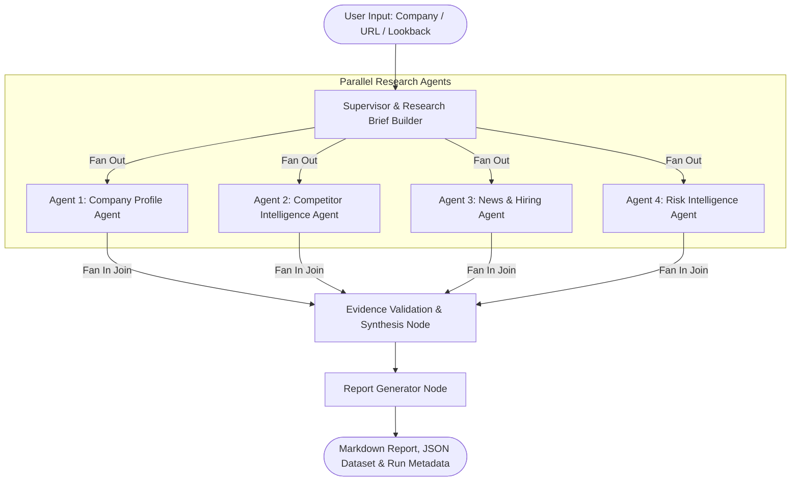

# MarketMind AI — Multi-Agent Company Intelligence Platform


**MarketMind AI** is a production-minded multi-agent market intelligence platform built with **Python 3.11**, **LangGraph**, **LangChain**, and **Pydantic v2**. 

Given a target company name or official website URL, MarketMind orchestrates **four specialized research agents running in parallel** across distinct investigative dimensions. Upon completion of all parallel branches, the system fans into an **evidence validation and synthesis stage** that cross-audits citations, detects contradictions, flags stale dates, and publishes structured intelligence reports in both **Markdown** and **JSON** formats.

---

## Architecture Overview

The platform uses LangGraph's `StateGraph` to ensure true workflow fan-out and fan-in join patterns. Each parallel agent writes to its own isolated state field, eliminating race conditions while merging atomic evidence records through reducer functions.



---

##  The Four Specialist Agents

### 1. Company Profile Agent (`agents/company_profile.py`)
- **Objective:** Establish an authoritative overview of the target enterprise.
- **Investigates:** Official domain, corporate description, core products/services, target customer segments, business model, disclosed funding rounds, lead investors, total capital raised, headquarters, operating regions, and historical milestones.
- **Scraper Engine:** Features a dual-engine architecture (`tools/founder_scraper.py`):
  - **Dynamic Engine:** Headless Playwright integration for Javascript-rendered SPAs and dynamic team sections.
  - **Static Engine:** BeautifulSoup parser evaluating Schema.org JSON-LD (`Organization.founder`, `Person`), semantic leadership cards, and LinkedIn URL associations.

### 2. Competitor Intelligence Agent (`agents/competitor_intelligence.py`)
- **Objective:** Map the competitive ecosystem and positioning.
- **Investigates:** Direct competitors, indirect competitors, and substitute products (such as open-weights models or in-house alternatives).
- **Comparison Table:** Generates a structured matrix containing:
  - Competitor name & website
  - Categorization (`DIRECT`, `INDIRECT`, `SUBSTITUTE`)
  - Products & services
  - Target segment
  - Public pricing (or `Quote-based / Tiered`)
  - Competitive positioning & differentiators
  - Verified source URLs

### 3. News and Hiring Agent (`agents/news_hiring.py`)
- **Objective:** Detect operational velocity, strategic shifts, and hiring signals.
- **Investigates:** Product announcements, acquisitions, major partnerships, executive changes, restructuring, and active job postings.
- **Time-Aware Intelligence:**
  - Configurable lookback period (defaults to **90 days**).
  - Explicitly separates article publication dates from event occurrence dates.
  - Flags undated or suspected stale job postings to prevent phantom vacancy claims.

### 4. Risk Intelligence Agent (`agents/risk_intelligence.py`)
- **Objective:** Uncover credible public signals of legal, regulatory, security, and reputational risk.
- **Investigates:** Documented lawsuits, regulatory inquiries (FTC, SEC, DOJ), security incidents/breaches, persistent service failures, and financial restructuring.
- **Epistemic Standards:**
  - Strictly distinguishes **Allegations**, **Ongoing Proceedings**, **Settlements**, and **Confirmed Findings**.
  - Does not infer guilt or liability from informal negative sentiment or uncorroborated reviews.
  - **Zero-Risk Invariant:** If no adverse records are discovered, the system explicitly states that no credible evidence was identified within the reviewed scope—it **never** claims the target has "zero risk".

---

## 🔍 Evidence Validation & Synthesis Engine

Unlike naive LLM summarizers that hallucinate facts or accept unverified claims, MarketMind incorporates an automated validation gatekeeper (`services/evidence_service.py` & `nodes/evidence_validation.py`):

1. **Atomic Evidence Tracing (`EvidenceRecord`):** Every factual claim is bound to an `evidence_id`, `source_url`, `publisher`, `retrieved_at` timestamp, and `confidence_score`.
2. **Citation Auditing:** Flags un-cited claims, missing sources, or malformed URLs before report publication.
3. **Contradiction Detection:** Evaluates cross-agent discrepancies (e.g. active funding rounds reported in profile vs. bankruptcy claims in risks).
4. **URL Validation & Deduplication:** Normalizes domains, filters duplicates, and prevents prompt injection from untrusted web pages.

---

## ⚡ Quickstart & Installation

### 1. Prerequisites
- Python 3.11+
- Virtual environment (recommended)

### 2. Clone and Install Dependencies
```bash
# Clone the repository
git clone https://github.com/Anamika-Suresh/whatsapp-chatbot.git
cd Business_Market_Analyst

# Install dependencies
pip install -r requirements.txt
```

### 3. Configuration (`.env`)
Copy `.env.example` to `.env` and configure your API keys:
```bash
cp .env.example .env
```

```ini
# Choose provider: 'groq', 'gemini', or 'mock'
LLM_PROVIDER=groq
LLM_MODEL=llama-3.3-70b-versatile

# Provider Keys (Optional if running in mock mode)
GROQ_API_KEY=your_groq_api_key_here
GOOGLE_API_KEY=your_gemini_api_key_here

# Search Engine: 'duckduckgo' or 'mock'
SEARCH_PROVIDER=duckduckgo
DEFAULT_LOOKBACK_DAYS=90
OUTPUT_DIR=runs
```

---

## CLI Usage Examples

### Full Live Research Run (Groq + DuckDuckGo)
```bash
python main.py --company "Anthropic" --url "https://www.anthropic.com" --days 90
```

### Run with Custom Focus & Lookback
```bash
python main.py --company "Stripe" --days 60 --focus "Enterprise revenue, API pricing, Adyen competition"
```

### Run Offline / Deterministic Mock Mode (Zero Credentials Required)
MarketMind can run completely offline without API keys or live network requests using its built-in mock providers:
```bash
python main.py --company "Anthropic" --mock-search --mock-llm
```

### Command-Line Arguments
| Option | Short | Description | Default |
| :--- | :--- | :--- | :--- |
| `--company` | `-c` | Name of the target company | Required if no URL |
| `--url` | `-u` | Official website URL | Optional |
| `--days` | `-d` | News and hiring lookback window in days | `90` |
| `--focus` | `-f` | Custom research priorities or questions | `None` |
| `--provider` | - | LLM provider override (`groq`, `gemini`, `mock`) | From config |
| `--model` | - | Specific model name | Provider default |
| `--output-dir` | `-o` | Output directory for reports | `runs` |
| `--mock-search` | - | Force deterministic mock search provider | `False` |
| `--mock-llm` | - | Force deterministic mock LLM model | `False` |

---

##  Output Artifacts Structure

Every run creates an isolated, timestamped output directory under `runs/`:
```
runs/
└── 20261014_165001_anthropic/
    ├── report.md           # Professional Markdown intelligence report
    ├── report.json         # Structured JSON report conforming to Pydantic models
    └── run_metadata.json   # Audit trail: timestamps, model used, search provider, and errors
```

---

##  Testing Suite

MarketMind AI includes a comprehensive test suite of **32 pytest unit and integration tests** verifying:
- Pydantic schema constraints and validation errors
- Company identity resolution and ambiguity prompts
- Search provider abstractions (DuckDuckGo & Mock)
- Founder scraper HTML fixture parsing (JSON-LD & semantic DOM)
- Individual agent outputs across all 4 domains
- True LangGraph parallel branch execution and fan-in join
- Partial agent failure resilience and graceful degradation
- Citation checking, contradiction detection, and deduplication
- Markdown and JSON report serialization

Run the test suite:
```bash
pytest -v
```

---

##  Design Decisions & Limitations

1. **Deterministic State Merging:** Rather than permitting parallel branches to race on shared state keys, each agent writes to its designated field (`company_profile`, `competitor_analysis`, etc.), while cross-cutting logs and evidences use `operator.add` reducers.
2. **Untrusted Web Content:** External web pages are treated strictly as untrusted text strings. The system never executes instructions or scripts discovered inside scraped pages.
3. **Graceful Degradation:** If an external search query fails or an individual agent throws an exception, the pipeline records the error in `errors` and synthesizes the remaining dimensions without crashing.
4. **Rate Limiting & Politeness:** `WebExtractor` enforces per-domain request intervals and caches identical URLs to prevent redundant network traffic and respect server resource limits.

---


